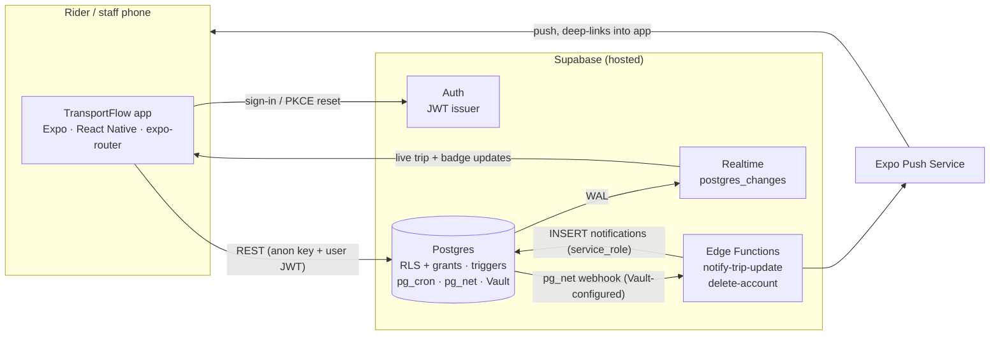
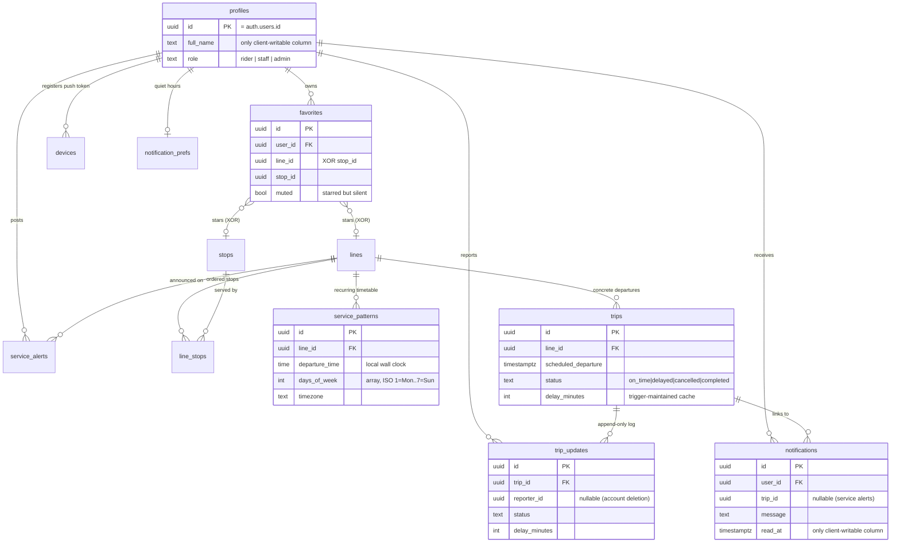
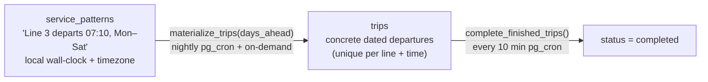
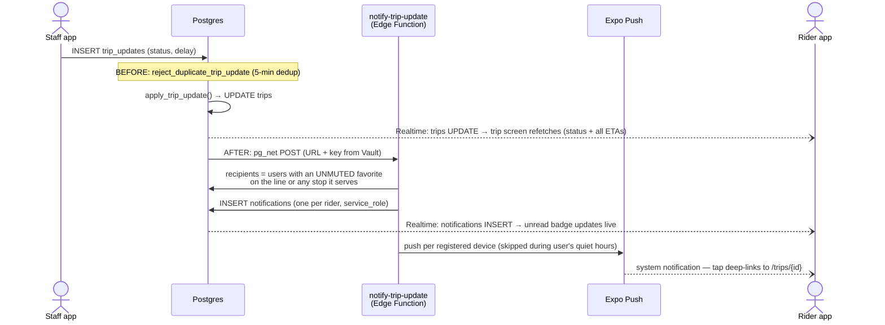

# TransportFlow — Technical Documentation (as built)

*Version 1.5.0 · July 2026 · describes the system as shipped, not as planned.
The original plan and its deviations are in `TransportFlow_Technical_Blueprint.md`.*

TransportFlow is a real-time public transport companion for riders and transit staff:
schedules, live delay/cancellation updates, favorites, service alerts, and push
notifications — one React Native codebase for both roles.

---

## 1. Architecture

The defining decision: **there is no application server.** The mobile app talks directly
to Supabase over PostgREST and Realtime, authenticated by a Supabase Auth JWT.
Authorization is enforced *in the database* — Row-Level Security policies, table grants,
and column-level grants — so there is no middleware to bypass and no second place where
rules live. The only server-side code is two small Deno Edge Functions for work that
genuinely needs elevated privileges.



**Stack:** Expo SDK 57 / React Native 0.86 / TypeScript · expo-router (typed routes) ·
`@supabase/supabase-js` v2 with generated DB types · react-native-maps (Google Maps on
Android, Apple Maps on iOS) · Supabase hosted Postgres 15+ with `pg_trgm`,
`earthdistance`, `pg_cron`, `pg_net`, Vault · Expo Push for notifications ·
EAS Build + EAS Update for delivery.

### Why no Express server (the trade-off)

| Concern | How it's covered without a server |
|---|---|
| AuthN | Supabase Auth issues JWTs; the client attaches them to every request |
| AuthZ | RLS policies + table/column grants, enforced by Postgres itself |
| Staff-only writes | RLS policies checking the caller's `profiles.role` |
| Server-side logic | Postgres triggers (state sync, dedup, webhooks) + Edge Functions |
| Scheduled jobs | `pg_cron` inside the database |
| Secrets | Supabase Vault (webhook URL + key never appear in schema or git) |

What's gained: one source of truth for authorization, no API layer to build/host/keep in
sync, free-tier friendly. What's given up: no place for arbitrary business logic in the
request path (accepted — every needed rule fit in SQL or an Edge Function).

---

## 2. Data model



Supporting objects not in the diagram:

- **`service_alerts`** — line-level announcements (`severity` info/warning/disruption,
  `starts_at`/`ends_at` window). A bulletin board, not a log: staff may amend/end them.
- **`devices`** — Expo push tokens per user; stale tokens are deleted when Expo answers
  `DeviceNotRegistered`.
- **`trip_stop_times` (view)** — one row per (trip, stop) with the ETA math done in SQL
  (offset + delay; `NULL` expected arrival when cancelled). Declared `security_invoker`
  so the underlying tables' RLS still applies. Clients render times; they never compute
  them.
- **RPCs** — `search_lines` / `search_stops` (trigram similarity + `word_similarity` +
  ILIKE, GIN-indexed: typo-tolerant search in pure SQL), `nearby_stops`
  (earthdistance GiST bounding-box prefilter + great-circle distance),
  `promote_to_staff` (see §4).

### The append-only pattern (core design)

Clients never `UPDATE trips`. A staff report is an **INSERT into `trip_updates`**; the
`apply_trip_update()` trigger (SECURITY DEFINER) syncs the trip's denormalized
`status`/`delay_minutes` in the same transaction. Corrections are new inserts, never
edits, so `trip_updates` is a complete audit trail — every state the network was ever in,
who reported it, and when. A `BEFORE INSERT` guard rejects an identical (status, delay)
repeat on the same trip within 5 minutes, because each accepted insert fans out real push
notifications.

### Scheduling inside Postgres

Trips are not hand-seeded rows; they are materialized from the recurring timetable by
`pg_cron` — no external scheduler exists.



Departure times are stored as local wall clock + timezone, so a 07:10 departure stays
07:10 across DST changes. A retention job prunes old `notifications` (the trip row is the
durable record).

---

## 3. Real-time & notification pipeline

One write powers everything downstream — the rider's live screen, the durable in-app
notification, the unread badge, and the push:



Details that matter:

- **Trigger ordering** is guaranteed by name sort (`…_insert` < `…_notify`), so the trip's
  current state is already synced when the webhook fires.
- **`service_alerts` INSERT rides the same webhook** to the same function, which branches
  on the payload's table name and reuses the favorites fan-out (deep link goes to the line).
- **Push is best-effort; the DB row is the record.** A failed Expo call is logged, never
  fails the webhook. Quiet hours suppress only the push — the in-app notification still
  appears.
- **Realtime is opt-in per table** (`supabase_realtime` publication: `trips`,
  `trip_updates`, `notifications`) and RLS-filtered per subscriber — a rider's socket only
  ever receives their own notification rows.
- The whole chain is a **no-op until the two Vault secrets** (`edge_url`,
  `edge_service_role_key`) are set — safe in fresh environments and CI.

---

## 4. Security model

Defense in depth, all of it in Postgres:

1. **Table grants are the ceiling.** The project does not auto-expose new tables; every
   table needed an explicit `GRANT` before any RLS policy could open it. `service_role`
   also has *no* implicit access — the Edge Function was granted exactly the tables it
   touches, nothing more.
2. **RLS policies narrow within the grants.** Catalog tables (`lines`, `stops`,
   `line_stops`, `service_patterns`): read-only to clients, no write policy at all —
   writes happen only via seed/import tooling with the service key. Owner-scoped tables
   (`favorites`, `devices`, `notification_prefs`): full CRUD where `user_id = auth.uid()`.
   `trips`: SELECT only — **no client write policy exists**; the only write path is the
   audit log + trigger.
3. **Column-level locks where row-level isn't enough.** `profiles` UPDATE is revoked and
   re-granted on `full_name` only, so a rider cannot self-promote by PATCHing `role` —
   Postgres answers with a clean permission error. Same pattern locks `notifications` to
   `read_at` only.
4. **Privileged paths are explicit and audited.** `promote_to_staff(uuid)` is the *only*
   client-reachable code that writes `role`: SECURITY DEFINER, self-gates on the caller
   being admin, EXECUTE revoked from anon. The first admin is a deliberate manual step.
   Trigger functions that must bypass RLS (`handle_new_user`, `apply_trip_update`) are
   SECURITY DEFINER with fixed, narrow behavior.
5. **Secrets in Vault, not in git.** The webhook trigger reads its URL and bearer key
   from Vault inside a SECURITY DEFINER function; client roles can never read Vault.
   The mobile app ships only the public anon key.
6. **Auth flows.** Email/password with PKCE password recovery
   (`transportflow://reset-password` deep link; the reset screen deliberately sits outside
   the auth-guarded navigation groups so it survives the signed-out → signed-in stack
   swap). Sign-up auto-creates the profile row via trigger, so no user can exist without
   one. Account deletion is an Edge Function that removes the auth user; personal data
   cascades away, while network history (past reports/alerts) is kept with attribution
   nulled — the UI renders a missing reporter as "Staff".

---

## 5. Mobile app

### Navigation (expo-router, typed routes)

```
Stack (root, auth-guarded)
├── (auth)/            sign-in · sign-up · forgot-password        [signed out]
├── (tabs)/            Home/search · Favorites · Notifications · Profile   [signed in]
├── nearby             location + map + list of stops within 3 km
├── lines/[id]         route map · stop timeline · alerts · departures · staff alert card
├── trips/[id]         live status · per-stop ETAs · report history · staff report card
└── reset-password     outside both guards (PKCE recovery target)
```

The root layout holds rendering until the persisted session is restored (no sign-in
flash), then mounts `usePushNotifications`, which registers the Expo token into `devices`
and routes notification taps to the right trip/line.

### Conventions

- **Design tokens only** — every color/size/radius comes from `src/lib/theme.ts`
  (Untitled-UI-derived palette); no hex literals in screens. Status is always icon/text +
  color, never color alone.
- **`useSupabaseQuery`** wraps all reads: loading vs. refreshing states (pull-to-refresh
  everywhere without spinner flicker), error strings, refetch.
- **Optimistic favorites** — star/bell flips instantly, override dropped once the refetch
  confirms, rolled back visibly on error.
- **Live screens subscribe, then refetch** — Realtime events trigger refetches rather
  than patching local state, keeping the server canonical.
- **Staff surfaces are amber-bordered cards** rendered inline in the rider UI, hidden
  unless `profile.role` is staff/admin — and enforced by RLS regardless of what the UI
  shows.
- Shared components: `Card`, `Row`, `Button`, `Chip`, `PillSelect`, `Star`, `StatusBadge`,
  `AlertBanner`, `EmptyState`, `ErrorText`, `FormInput`/`PasswordInput`, `ModeIcon`,
  `StopsMap` (with a `.web.tsx` stub to keep native maps out of web bundles).

---

## 6. Real data: GTFS import

`scripts/gtfs-import` maps any standard GTFS feed onto the app's model: routes → `lines`,
stops → `stops`, each route's **dominant stop sequence** → `line_stops`, and departure
times → `service_patterns` (weekly patterns; trips then materialize via the existing
pg_cron job). IDs are md5-derived from GTFS IDs, so re-runs upsert idempotently and
switching cities is just running it with another feed.

Known simplifications: only the dominant variant of each route survives (reverse
direction and school-run variants are dropped), `calendar_dates` exceptions are ignored,
and per-trip travel-time differences collapse to the representative trip's offsets.

Currently imported: **the Tunisian network** (open data, catalogue-data.transport.tn) —
TRANSTU (Tunis métro + TGM), SORETRAK (Kairouan), SNTRI (intercity), Métro du Sahel and
STS (Sousse): 78 lines / 474 stops across five feeds, namespaced with per-feed
`--prefix` so they coexist.

---

## 7. Build, release & operations

| Concern | Implementation |
|---|---|
| Binary builds | EAS Build — `development` (dev client), `preview` (internal APK), `production` (auto-increment). Supabase URL + anon key are baked per-profile via `eas.json` |
| Day-to-day shipping | **EAS Update (OTA)**: JS-only changes ship with `eas-cli update --channel preview`; updates download in the background and apply on next launch. New APK only for native changes (runtime version follows `appVersion`) |
| Push credentials | FCM V1 (Firebase service-account key on EAS via `eas credentials`) + `google-services.json` in the build |
| Maps (Android) | Google Maps SDK; API key injected at build time from `google-services.json` by `app.config.js` — the key's GCP allowlist must include Maps SDK for Android |
| Auth email | Custom SMTP (Gmail, 465) on hosted Supabase — signup confirmation ON, password recovery via PKCE deep link |
| Free-tier survival | GitHub Action pings the REST API Mon+Thu so the hosted project never auto-pauses |
| DB migrations | Numbered SQL files in `supabase/migrations`, replayed by `supabase db reset` locally and applied to hosted via the Management API |
| Type safety | `supabase gen types typescript` → `database.types.ts`; every query is typed end-to-end |

## 8. Testing & known limitations

**Verification approach:** manual on-device verification of every flow (the full loop —
staff report → live rider update → push → deep link — verified on physical hardware
against the hosted backend), plus `tsc --noEmit` type checking across the typed-routes +
generated-DB-types surface, and RLS smoke tests via psql role/JWT-claim impersonation.
There is no automated test suite — with no API layer of our own, the highest-risk logic
lives in SQL (policies, triggers), which was exercised directly.

**Known limitations (deliberate scope):**
- One direction per line (GTFS reverse variants dropped); no holiday calendar exceptions.
- No vehicle GPS tracking — "real-time" means staff-reported status, which matches the
  product's operator-in-the-loop design.
- No ticketing/payments, no multi-city switching in the UI, no offline mode beyond
  cached screens.
- Light theme only; accessibility labels exist on icon buttons but no full audit was done.
- Free-tier constraints: Realtime connection caps and Edge Function cold starts are
  acceptable at demo scale, unmeasured beyond it.
