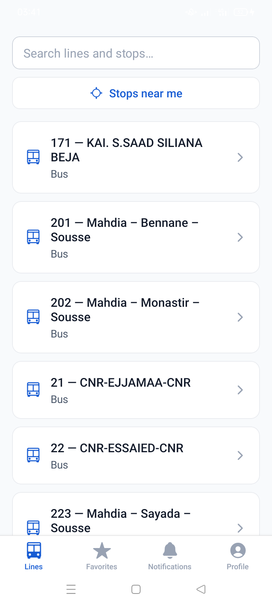
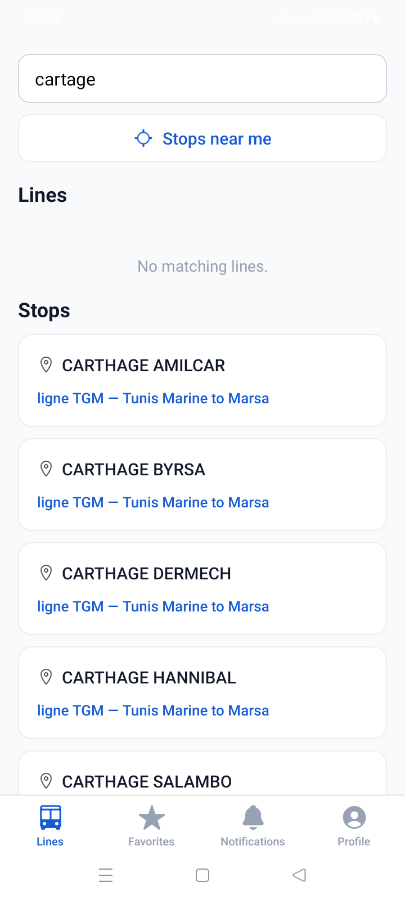
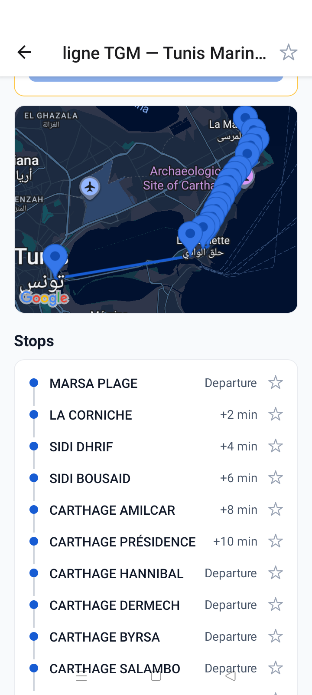
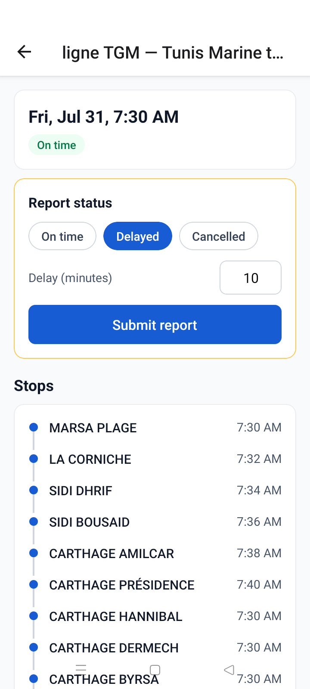
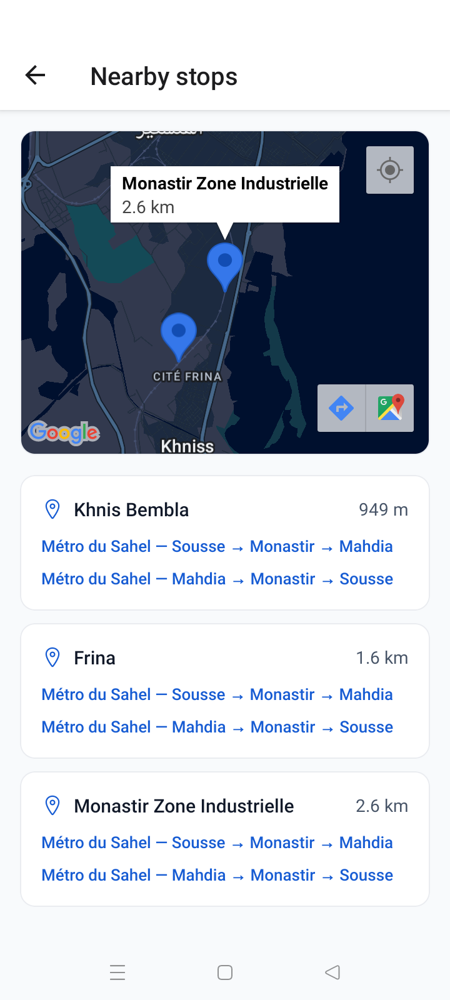
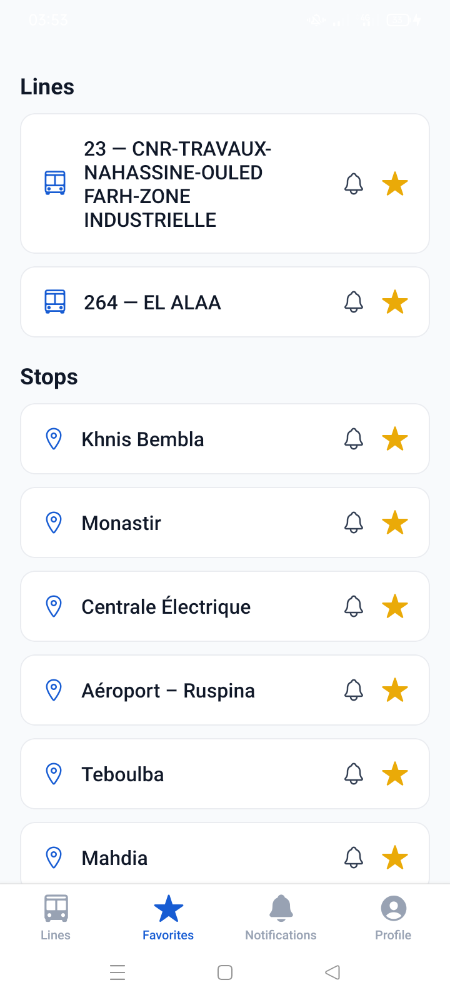
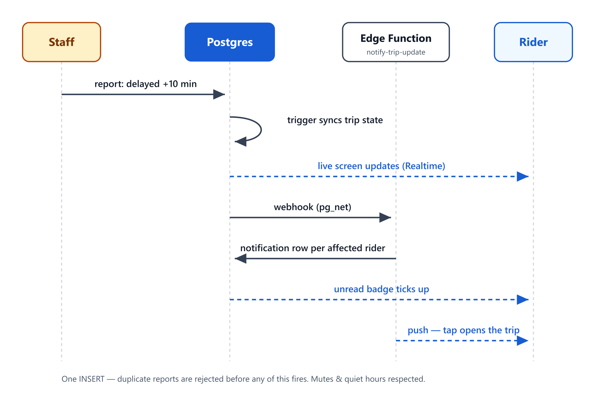
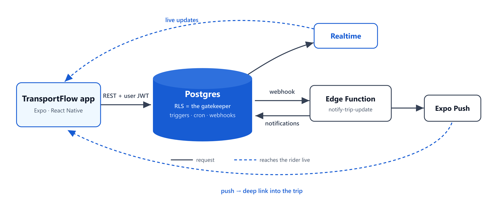

# TransportFlow

A real-time public transport companion app for riders and transit staff. Riders browse
lines, stops and departures, star their favorites, and get push notifications for delays,
cancellations and service alerts. Staff report trip status and post line-level alerts from
the same app.

Built as a single React Native (Expo) codebase talking **directly to Supabase** — there is
no custom API server. Authorization lives in Postgres (Row-Level Security + column grants),
and the only server-side code is two small Edge Functions.

**Current version: 1.5.0** (Expo SDK 57, React Native 0.86, supabase-js v2).

---

## Screenshots

Captured on-device from the 1.5.0 production build, against the live Tunisian network.

| Home &amp; search | Typo-tolerant search | Line detail |
|:---:|:---:|:---:|
|  |  |  |
| Lines across five networks | `cartage` → Carthage stops (pg_trgm) | Route map + ordered stop timeline |

| Live trip | Nearby stops | Favorites |
|:---:|:---:|:---:|
|  |  |  |
| Per-stop ETAs + staff report card | 3 km radius, distances + serving lines | Stars with per-favorite mute bells |

The amber-bordered card on the trip screen is a staff-only surface — it renders inline in
the rider UI and is gated by role in the UI and, authoritatively, by RLS.

---

## Features

### Riders
- **Browse & search** — line list with typo-tolerant search over lines and stops
  (pg_trgm-backed `search_lines` / `search_stops` RPCs, debounced), stop results decorated
  with the lines serving them.
- **Line detail** — route map, ordered stop timeline, active service alerts, upcoming
  departures.
- **Trip detail (live)** — per-stop ETAs computed server-side (`trip_stop_times` view),
  status badge, and a full report history. Updates stream in over Supabase Realtime —
  no refresh needed.
- **Nearby stops** — foreground location + `nearby_stops` RPC (earthdistance, 3 km
  radius), shown on a map and as a list with distances and serving-line chips.
- **Maps** — Google Maps on Android / Apple Maps on iOS (react-native-maps) for the line
  route and nearby-stops views.
- **Favorites** — star any line or stop (optimistic toggles); a per-favorite mute bell
  keeps it starred but excludes it from notifications.
- **Notifications** — durable in-app notification list with unread styling, a live unread
  badge on the tab (Realtime-driven), mark-as-read on visit, and Expo push notifications
  that deep-link to the affected trip or line.
- **Quiet hours** — per-user window (user-local wall clock, midnight wrap supported)
  during which pushes are suppressed but the in-app notification is still recorded.
- **Account** — email/password auth, password reset via PKCE deep link
  (`transportflow://reset-password`), name editing, password change, and in-app account
  deletion (Play Store requirement) via the `delete-account` Edge Function.

### Staff & admins
- **Report trip status** (on time / delayed +minutes / cancelled) from the trip screen.
  Reports are INSERTs into an append-only `trip_updates` audit log; a trigger syncs the
  trip's current state. A duplicate-report guard rejects identical repeats within 5 minutes.
- **Post service alerts** on a line (info / warning / disruption, e.g. "strike Friday").
  Unlike trip reports, alerts can be amended/ended later.
- **Admin role** — superset of staff; admins can promote users to staff via the
  `promote_to_staff` RPC (the only client-reachable path that writes `profiles.role`).
- Staff-only cards render inline in the rider UI (amber-bordered), gated by role both in
  the UI and — authoritatively — by RLS.

### Notification fan-out (no app server)

One staff INSERT drives everything below — trip state, live screens, durable
notifications and pushes:



In code: `apply_trip_update()` syncs the trip's current-state columns, `notify_*_webhook()`
POSTs the row via pg_net, and the `notify-trip-update` Edge Function (service_role) finds
riders with an unmuted favorite on the line or a stop it serves, INSERTs a durable
`notifications` row per rider, and sends Expo push to registered devices (best-effort,
respecting quiet hours).

The webhook URL and key live in Supabase Vault (no secrets in schema or git); the trigger
is a safe no-op until both secrets are configured.

---

## Architecture



There is no application server in that picture. The app holds only the public anon key
plus the signed-in user's JWT; Postgres itself decides what each request may read or
write. Alongside the database, Supabase provides Auth, Realtime, pg_net webhooks, pg_cron
scheduling, and the two Edge Functions (`notify-trip-update`, `delete-account`).

Key decisions (deviations from the original blueprint):
- **No Express/Node API server.** The app uses the anon key + user JWT; every table is
  protected by RLS and table/column grants. Staff-only writes are RLS policies, not
  middleware. Server-side logic that genuinely needs privileges is in Edge Functions.
- **Append-only event log instead of row updates.** Clients never UPDATE `trips`; staff
  INSERT into `trip_updates` and a `SECURITY DEFINER` trigger syncs the denormalized
  current state. Every status change is attributable.
- **Scheduling inside Postgres.** `service_patterns` (recurring timetable rows, local
  wall-clock times, ISO weekday sets) are materialized into concrete `trips` by a nightly
  pg_cron job (`materialize_trips`); another job marks trips `completed` after their last
  stop. Old notifications are pruned by a retention job.
- **Google Maps (react-native-maps)** — the Android API key is injected at build time
  from `google-services.json` by `mobile/app.config.js` (override with
  `GOOGLE_MAPS_ANDROID_API_KEY`). Versions 1.2.0–1.4.0 shipped MapLibre + OpenFreeMap
  while GCP billing was unavailable; 1.5.0 restored Google Maps.
- **Plain StyleSheet + theme tokens** (`mobile/src/lib/theme.ts`) instead of NativeWind.

## Repository layout

```
mobile/                     Expo app (see mobile/src)
  src/app/                  expo-router routes
    (auth)/                 sign-in, sign-up, forgot-password
    (tabs)/                 home/search, favorites, notifications, profile
    lines/[id].tsx          line detail (map, stops, alerts, departures)
    trips/[id].tsx          live trip detail (ETAs, report history)
    nearby.tsx              nearby stops (location + map)
    reset-password.tsx      PKCE recovery target (outside the auth guards)
  src/components/           Card, Row, Button, Chip, PillSelect, Star, StatusBadge,
                            AlertBanner, StopsMap(.web), StaffReportCard, StaffAlertCard, …
  src/lib/                  supabase client + generated DB types, auth context,
                            useSupabaseQuery, useFavorites, useUnreadCount,
                            push-notification hook, theme tokens
supabase/
  migrations/               schema, RLS, webhooks, scheduling, search/nearby, views
  functions/                notify-trip-update (fan-out), delete-account
  seed.sql                  demo network + local-only Vault wiring
scripts/gtfs-import/        import a real GTFS feed into the app's model
.github/workflows/          free-tier keep-alive ping (Mon+Thu)
Docs/screenshots/           on-device captures and diagrams used in this README
```

## Data model (Postgres)

| Object | Purpose |
|---|---|
| `profiles` | one per auth user; `role` in rider/staff/admin (column write-locked; only `full_name` is client-writable) |
| `lines`, `stops`, `line_stops` | network catalog (seed/import only; no client write path) |
| `service_patterns` | recurring timetable (departure time + ISO weekdays + timezone) |
| `trips` | concrete departures, materialized by pg_cron; current status/delay are trigger-maintained caches |
| `trip_updates` | append-only staff report log (audit trail; INSERT-only for staff/admin) |
| `service_alerts` | line-level announcements with severity and active window |
| `favorites` | starred line **or** stop per row, with `muted` flag |
| `devices` | Expo push tokens (stale tokens auto-pruned on `DeviceNotRegistered`) |
| `notifications` | durable per-user notification history; `read_at` is the only client-writable column |
| `notification_prefs` | quiet-hours window + timezone |
| `trip_stop_times` (view) | server-side per-stop ETAs (`security_invoker`, so RLS still applies) |
| RPCs | `search_lines`, `search_stops` (pg_trgm), `nearby_stops` (earthdistance), `promote_to_staff` (admin-only, SECURITY DEFINER) |

Security highlights: RLS on every table; explicit table grants as the privilege ceiling;
column-level grants lock `profiles.role` and notification fields; riders cannot
self-promote; notifications are only written by the service-role Edge Function; account
deletion nulls staff attribution instead of deleting network history.

## Development

The **hosted Supabase project is the primary backend** (`mobile/.env` points at it; the
preview/production build profiles bake the URL and anon key via `eas.json`). A full local
stack is optional:

```sh
pnpm supabase start       # local stack (Docker; heavy)
pnpm supabase db reset    # replay migrations + seed
```

Demo accounts (local seed): `rider-demo@transportflow.app` / `staff-demo@transportflow.app`
(password `password123`).

Mobile app:

```sh
cd mobile
pnpm install
pnpm exec expo start      # requires the EAS development build installed on-device
```

Notes:
- **Expo Go is not supported** (crashes on some devices; push is unavailable there anyway).
  Use the EAS development build.
- The old `.npmrc` (`legacy-peer-deps`) is gone: it was npm-specific, and pnpm already
  tolerates the unmet `react-dom` peer that Expo's transitive web packages declare.
  `react` stays pinned at a single copy — verify with `pnpm why react` after dep changes.
- After schema changes, regenerate types:
  `pnpm supabase gen types typescript --local > mobile/src/lib/database.types.ts`
- All colors/spacing come from `src/lib/theme.ts` — no hardcoded hex in screens.
- Data fetching goes through `useSupabaseQuery` (loading/refreshing/error states,
  pull-to-refresh everywhere).

## Builds & releases

- **EAS Build** profiles: `development` (dev client), `preview` (internal APK,
  channel `preview`), `production` (auto-incrementing version).
- **OTA updates (EAS Update)** are the day-to-day ship path for JS-only changes:
  `cd mobile && pnpm dlx eas-cli update --channel preview --message "..."` — updates download in
  the background and apply on next launch. A new APK is only needed when native modules or
  native config change (runtime version follows `appVersion`).
- Android push delivery uses FCM V1 (a Firebase service-account key is configured on EAS
  via `eas credentials`) and needs a real device build.
- Auth emails (signup confirmation, password recovery) are sent through custom SMTP
  (Gmail) configured on the hosted Supabase project; signup email confirmation is ON.
- A scheduled GitHub Action pings the REST API twice a week so the Supabase free-tier
  project never pauses (runs from the default branch; needs the `SUPABASE_ANON_KEY` secret).

## Importing real network data

`scripts/gtfs-import` maps any standard GTFS feed onto the app's model (dominant stop
sequence per route, weekly patterns; see its README for what's simplified). The imported
network is **Tunisian** (open data from catalogue-data.transport.tn): TRANSTU (Tunis
métro + TGM), SORETRAK (Kairouan), SNTRI (intercity), Métro du Sahel, and STS (Sousse) —
78 lines / 474 stops, imported with per-feed `--prefix` namespaces.

```sh
cd scripts/gtfs-import && pnpm install
node index.mjs --file feed.zip --dry-run              # preview SQL
SUPABASE_ACCESS_TOKEN=sbp_... node index.mjs --url <gtfs-url>   # apply to hosted project
```

## Documentation

This README is the project's documentation — architecture, data model, security model,
development and build steps are all above. Two components document themselves in more
detail:

- `supabase/functions/notify-trip-update/README.md` — fan-out function config & local testing.
- `scripts/gtfs-import/README.md` — GTFS import details and limitations.
